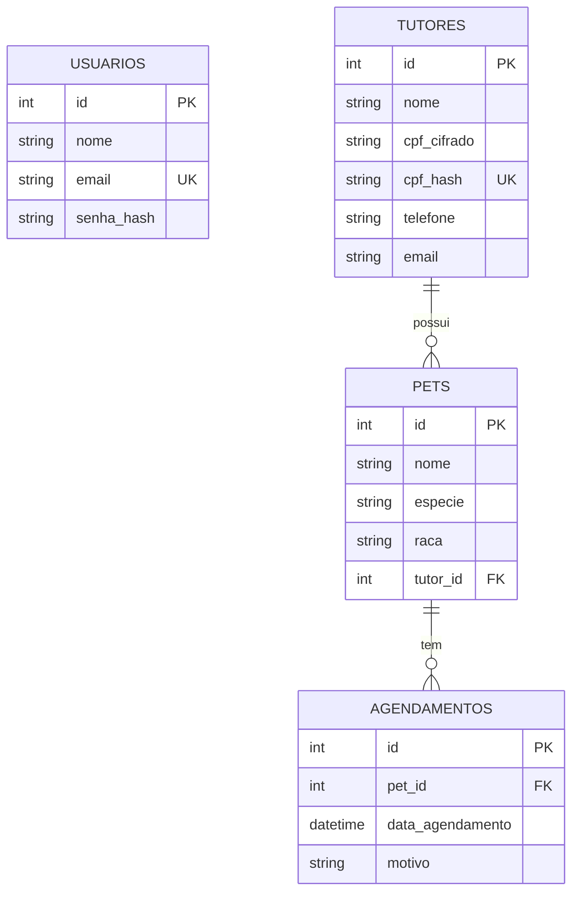

# Clínica Veterinária — Sistema de Agendamentos

Sistema web para a recepção da clínica da Dra. Helena Souza (usuário: Marcos).

## Requisitos atendidos
| Requisito | Como foi feito |
|---|---|
| Acesso só com login | `POST /api/auth/login` + JWT; todas as rotas `/api/*` (exceto login) exigem token |
| Sessão expira sozinha | JWT com validade de 15 min + logout automático por inatividade no front |
| Aviso de senha errada | API retorna "Senha incorreta." / "Usuário não encontrado." e a tela exibe |
| Tela inicial clara | Mostra usuário logado, atalhos para Tutores/Pets/Agendamentos e botão Sair |
| Busca de tutores | Campo de busca filtra por nome (`LIKE`) a cada digitação; CRUD completo |
| CPF protegido (LGPD) | CPF salvo **cifrado com AES-256-GCM**; `cpf_hash` (HMAC-SHA256) só para impedir duplicidade |
| Todo pet tem tutor | `tutor_id NOT NULL` + FK no banco e validação na API |
| Agenda | Lista ordenada por `data_agendamento` com dados de tutor e pet (JOIN) + remarcar data |
| Documentação | Este arquivo |

## Tecnologias
Node.js, Express 5, MySQL (mysql2), bcryptjs (senhas), jsonwebtoken (sessão), crypto nativo (AES-256-GCM), HTML/CSS/JS puro.

## Como rodar (PowerShell)
1. Abra o arquivo `.env` e troque `COLOQUE_AQUI_A_SENHA_DO_MYSQL` pela senha do seu MySQL (o `CPF_KEY` já vem preenchido).
2. Execute:
```powershell
npm install
npm run setup    # cria banco, tabelas e o usuário marcos@clinica.com / 123456
npm start        # http://localhost:3000
```

## Endpoints
| Método | Rota | Descrição |
|---|---|---|
| POST | /api/auth/login | login |
| GET/POST | /api/tutores (`?busca=`) | listar/criar |
| PUT/DELETE | /api/tutores/:id | editar/excluir |
| GET/POST | /api/pets | listar/criar |
| PUT/DELETE | /api/pets/:id | editar/excluir |
| GET/POST | /api/agendamentos | agenda ordenada por data / criar |
| PATCH | /api/agendamentos/:id/data | remarcar |
| DELETE | /api/agendamentos/:id | cancelar |

## Diagrama do banco

